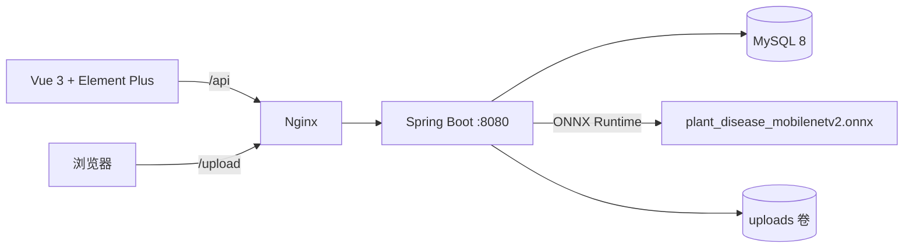

# 植物叶片病害识别与防治系统

> 一个「AI 模型 + 后端服务 + Web 前端」的完整植物病害识别项目：上传叶片照片，基于 MobileNetV2 ONNX 模型识别 39 类作物/病害，返回置信度并给出防治建议，同时记录识别历史与统计图表。


---

## 项目简介

项目分为三部分：

| 模块 | 技术栈 | 说明 |
| --- | --- | --- |
| `ai_model` | PyTorch + torchvision + ONNX | MobileNetV2 迁移学习、训练评估、ONNX 导出与校验 |
| `plant-disease-server` | Spring Boot 2.7 / Java 17 / MyBatis / ONNX Runtime | 登录鉴权、图片识别、病害知识库、历史记录、统计接口 |
| `plant-disease-web` | Vue 3 + Vite + Element Plus + ECharts | 登录、识别、历史记录、数据统计、病害知识库页面 |

核心链路：

```text
浏览器上传图片 -> 后端保存图片 -> ONNX Runtime 加载模型推理 -> softmax 置信度
-> 查询病害详情/防治方案 -> 写入识别记录 -> 返回前端展示
```

## 功能清单

- **用户体系**：注册、登录、修改密码；BCrypt 密码加密；JWT 无状态认证。
- **病害识别**：上传 JPG/PNG 叶片图片，返回病害信息、置信度、图片地址；支持单张和批量识别（最多 10 张）。
- **病害知识库**：39 类模型类别，支持按作物筛选，展示病害症状与防治方案。
- **识别历史**：分页查询、详情、删除（按用户隔离，不能删除他人记录），支持导出 CSV。
- **数据统计**：总识别数、病害种类数、今日/近 7 天识别数、作物分布、病害分布、近 7 天趋势。
- **前端体验**：图片本地预览、识别结果卡片、ECharts 图表、统一异常提示、路由守卫。

## AI 模型

- **网络**：MobileNetV2（ImageNet 预训练），替换分类头为 `Dropout + Linear(1280, 39)`。
- **输入**：224×224 RGB，ImageNet 均值/方差归一化。
- **分类数**：39（PlantVillage 38 类 + `x_Removed_from_Healthy_leaves`）。
- **训练策略**：随机旋转/水平翻转/垂直翻转/颜色抖动；按 8:1:1 划分训练/验证/测试；交叉熵 + Adam，30 epochs。
- **评估**：Accuracy / Precision / Recall / F1、混淆矩阵、训练曲线。
- **部署**：导出 ONNX（opset 12），后端使用 ONNX Runtime Java 推理，不依赖 Python 环境。
- **类别映射**：模型输出的是类别索引，后端读取 `class_names.txt` 得到类名，再按 `disease_info.en_name` 查询病害详情，不依赖训练顺序或数据库自增 id。

训练与导出说明见 [ai_model/README.md](ai_model/README.md)。

> 仓库不包含 PlantVillage 数据集（体积较大），训练前请按 README 放到指定目录。

## 系统架构



## 快速开始

### 方式一：Docker Compose（推荐）

前置条件：Docker Engine / Docker Desktop（Compose v2）。

```bash
cp .env.example .env
# 修改 .env 中的数据库密码和 JWT_SECRET
docker compose up -d --build
docker compose ps
```

启动后：

| 服务 | 地址 |
| --- | --- |
| Web 前端 | <http://localhost> |
| 后端 API 文档 | <http://localhost:8080/swagger-ui.html> |
| 健康检查 | <http://localhost:8080/actuator/health> |
| MySQL（宿主机） | `localhost:3307`，库名 `plant_disease` |

演示账号：`admin / 123456`（初始化脚本内置，生产环境请修改）。

> 数据库初始化脚本只在 MySQL 数据卷首次创建时执行。重置数据请执行 `docker compose down -v` 后重新启动。

### 方式二：本地运行

前置条件：JDK 17、Maven 3.9+、MySQL 8。

```bash
# 1. 初始化数据库
mysql -uroot -p -e "CREATE DATABASE IF NOT EXISTS plant_disease DEFAULT CHARACTER SET utf8mb4 COLLATE utf8mb4_unicode_ci;"
mysql -uroot -p plant_disease < plant-disease-server/src/main/resources/db/plant_disease.sql

# 2. 构建并启动后端
cd plant-disease-server
mvn clean package -DskipTests

export DB_PASSWORD=你的密码
export JWT_SECRET=至少32字节的随机字符串
export MODEL_PATH=$(pwd)/../plant_disease_mobilenetv2.onnx
export UPLOAD_PATH=$(pwd)/upload/

java -jar target/plant-disease-server.jar
```

前端开发模式：

```bash
cd plant-disease-web/plant-disease-web
npm ci
npm run dev
```

Vite 会把 `/api` 和 `/upload` 代理到 `http://localhost:8080`。

## 配置说明

| 环境变量 | 默认值 | 说明 |
| --- | --- | --- |
| `SERVER_PORT` | `8080` | 服务端口 |
| `DB_HOST` / `DB_PORT` | `localhost` / `3306` | MySQL 地址 |
| `DB_NAME` | `plant_disease` | 数据库名 |
| `DB_USERNAME` / `DB_PASSWORD` | `root` / 空 | 数据库账号 |
| `JWT_SECRET` | 开发用默认值 | 至少 32 字节，生产必须替换 |
| `JWT_EXPIRATION` | `86400000` | token 有效期（毫秒） |
| `MODEL_PATH` | `./plant_disease_mobilenetv2.onnx` | ONNX 模型路径 |
| `UPLOAD_PATH` | `./upload/` | 上传图片目录 |

Docker Compose 额外变量见 [`.env.example`](.env.example)。

## 项目结构

```text
plant-disease/
├── ai_model/                       # 训练与导出脚本
│   ├── train.py
│   ├── export_onnx.py
│   ├── preprocess_utils.py
│   ├── class_names.txt
│   ├── best_model.pth
│   ├── plant_disease_mobilenetv2.onnx
│   ├── train_curve.png
│   ├── confusion_matrix.png
│   └── README.md
├── plant-disease-server/           # Spring Boot 后端
│   ├── src/main/java/com/plant/disease
│   │   ├── config/                 # Web 配置、项目配置属性
│   │   ├── controller/             # 用户、识别、记录、统计、病害
│   │   ├── service/                # 业务与 ONNX 推理
│   │   ├── interceptor/            # JWT 登录拦截器
│   │   └── utils/                  # JWT 工具
│   └── src/main/resources/
│       ├── application.yml
│       ├── class_names.txt          # 模型类别名（后端按类名映射病害数据）
│       ├── db/plant_disease.sql    # 建表 + 病害/防治数据 + 演示账号
│       └── mapper/
├── plant-disease-web/plant-disease-web/  # Vue 3 前端
│   ├── src/views/                  # 登录、识别、记录、统计、知识库
│   ├── nginx.conf
│   └── Dockerfile
├── plant_disease_mobilenetv2.onnx  # 后端使用的模型
├── Dockerfile
├── docker-compose.yml
└── .env.example
```

## API 概览

| 方法 | 路径 | 说明 |
| --- | --- | --- |
| POST | `/api/user/register` | 注册 |
| POST | `/api/user/login` | 登录，返回 JWT |
| POST | `/api/user/updatePassword` | 修改密码 |
| POST | `/api/recognize/upload` | 上传单张图片识别（multipart，字段名 `file`） |
| POST | `/api/recognize/batch` | 批量识别（multipart，字段名 `files`，最多 10 张） |
| GET | `/api/record/page` | 分页查询识别记录 |
| GET | `/api/record/{id}` | 识别记录详情 |
| DELETE | `/api/record/{id}` | 删除自己的识别记录 |
| GET | `/api/record/export` | 导出识别记录 CSV（UTF-8 BOM，Excel 直接打开） |
| GET | `/api/disease/list` | 病害列表（可按作物筛选） |
| GET | `/api/disease/{id}` | 病害详情 + 防治方案 |
| GET | `/api/statistics/overview` | 概览统计 |
| GET | `/api/statistics/diseaseType` | 病害分布 |
| GET | `/api/statistics/cropCount` | 作物分布 |
| GET | `/api/statistics/dailyCount` | 近 7 天趋势 |

除登录/注册外，接口需要请求头 `token: <jwt>`（也兼容 `Authorization: Bearer <jwt>`）。

## 构建与测试

```bash
# 后端
cd plant-disease-server
mvn clean package

# 前端
cd plant-disease-web/plant-disease-web
npm ci
npm run build
```

后端目前以编译/启动验证为主，核心链路的验证方式是：启动 MySQL + 后端，登录后上传一张叶片图片，确认返回的 `diseaseId`、`confidence` 与识别记录。

## 安全提醒

- 部署前修改 `JWT_SECRET`、`DB_PASSWORD` 和演示账号密码。
- 生产环境建议使用 HTTPS、限制上传文件类型/大小、对识别接口做限流。
- 训练数据集和 `.venv` 不进入仓库，避免仓库体积膨胀。

## 说明

模型使用公开的 PlantVillage 数据集训练/微调；识别结果仅作为辅助参考，实际病害防治请结合农技人员意见。
