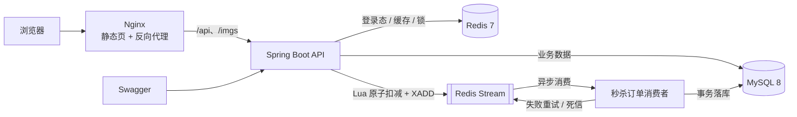
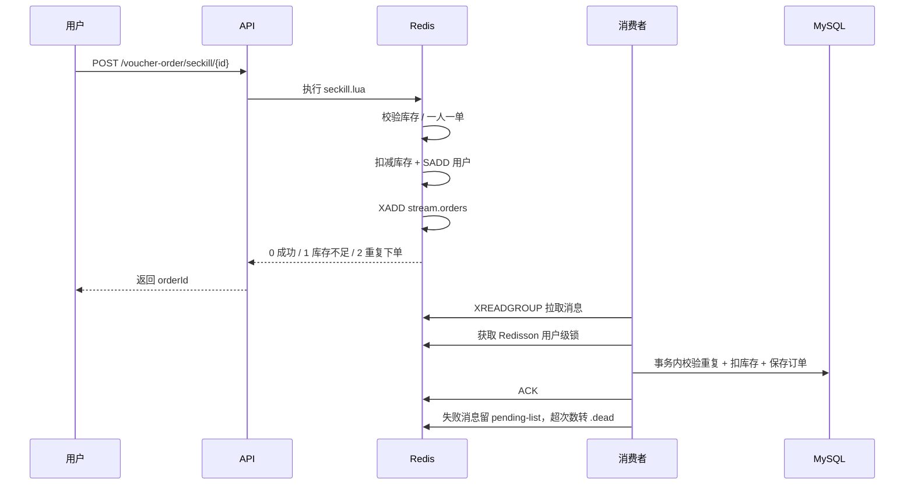

# 探店 TanDian · 本地生活服务平台

> 一个用 Spring Boot 3 + Redis 实现的本地生活服务后端，覆盖登录、商铺、探店笔记、关注 Feed、优惠券秒杀等核心链路，重点实践缓存一致性与高并发下的可靠性设计。


---

## 项目简介

本项目聚焦后端 API，核心目标不是堆功能，而是把「缓存 + 分布式锁 + 消息队列」这些高并发常用手段落到一个能跑、能讲清楚的业务里：

- **登录态**：Redis Hash 保存用户信息，token 滑动续期，验证码 60 秒发送限流。
- **商铺查询**：Cache-Aside + 空值缓存防穿透 + Redisson 互斥锁防击穿。
- **附近商铺**：Redis GEO 按距离检索，再按距离顺序回表。
- **探店笔记**：点赞排行（ZSet）、关注关系、推模式 Feed、评论增删。
- **优惠券秒杀**：Lua 原子校验 + Redis Stream 异步下单 + Redisson 保证一人一单 + pending-list 重试 + 死信队列。
- **工程化**：配置全部外置为环境变量、统一异常处理、接口文档、健康检查、Docker Compose 一键启动。

> 仓库只包含后端服务；接口可以通过 Swagger UI 或任意 HTTP 客户端直接调试。

## 功能清单

| 模块 | 功能 |
| --- | --- |
| 用户 | 手机验证码登录、登出、获取当前用户、每日签到/连续签到统计 |
| 商铺 | 商铺详情缓存、分类列表缓存、按类型分页、按名称搜索、附近商铺（GEO） |
| 笔记 | 发布笔记、热门笔记、笔记详情、点赞/取消点赞、点赞用户列表 |
| 关注 | 关注/取关、是否关注、共同关注 |
| Feed | 关注流滚动分页（ZSet 时间戳 + offset） |
| 评论 | 评论列表、发表评论、删除自己的评论、笔记评论数维护 |
| 秒杀 | 秒杀券创建、Redis 库存预热、Lua 扣减、用户级限流、异步落库、失败重试、死信管理与重放 |
| 文件 | 图片上传、删除、静态资源访问（路径穿越校验） |
| 运维 | Actuator 健康检查、Swagger/OpenAPI、Docker Compose |

## 技术栈

- **语言/框架**：Java 21、Spring Boot 3.1.5、Spring MVC、Validation、AOP
- **持久层**：MyBatis-Plus 3.5.7、MySQL 8.0、HikariCP
- **缓存/并发**：Redis 7、Lettuce、Redisson 3.27、Lua、Redis Stream
- **文档/监控**：Springdoc OpenAPI 2.3、Spring Boot Actuator
- **前端**：HTML + Vue 2 + Element UI（`frontend/`，黑马点评课程配套页面）
- **构建/部署**：Maven 3.9、Docker 多阶段构建、Docker Compose、Nginx

## 系统架构



## 核心设计

### 1. 登录态：Redis Hash + 滑动过期

- 验证码存 `login:code:{phone}`，2 分钟过期；同一手机号 60 秒内只能发送一次。
- 登录成功后生成随机 token，用户信息存 `login:token:{token}`（Hash），默认 30 分钟。
- 每次请求在拦截器中刷新 TTL，实现滑动续期；请求结束清理 `ThreadLocal`，避免线程池复用导致的内存泄漏。
- 支持 `Authorization: <token>` 和 `Authorization: Bearer <token>` 两种写法。

### 2. 商铺缓存：穿透、击穿、雪崩

- **穿透**：查询不存在的商铺时缓存空字符串，TTL 2 分钟。
- **击穿**：缓存失效时用 Redisson 分布式锁保证只有一个请求回源，获取锁后二次检查缓存。
- **雪崩**：不同商铺的 TTL 为固定 30 分钟，生产环境建议叠加随机抖动；当前实现优先保证代码可读性。
- 更新商铺后主动删除缓存，避免脏读。

详细分析见 [docs/cache-design.md](docs/cache-design.md)。

### 3. 秒杀：Lua + Stream + Redisson



关键点：

- **原子性**：库存校验、一人一单、扣减、写消息全部在 Lua 中完成，避免并发超卖。
- **异步削峰**：接口只做 Redis 操作，数据库写入由单线程消费者完成。
- **幂等**：落库前再查一次 `user_id + voucher_id`，防止消息重复投递。
- **可靠性**：处理失败不 ACK，消息留在 pending-list；下次启动或异常时重试；超过 5 次投递转入 `stream.orders.dead`。
- **补偿**：数据库扣库存失败时回滚 Redis 预占的库存和用户标记。
- **限流**：`seckill-rate.lua` 按用户维度做每秒请求数限制，防止脚本刷接口。
- **运维**：提供 pending 统计、死信查询和死信重放接口（需要 `X-Admin-Token`）。
- **数据库兜底**：`tb_voucher_order` 增加 `(user_id, voucher_id)` 唯一索引，防止极端并发下重复订单。

详细分析见 [docs/seckill-design.md](docs/seckill-design.md)。

### 4. 附近商铺：Redis GEO

- 启动时按分类把商铺坐标写入 `shop:geo:{typeId}`。
- 查询时用 `GEOSEARCH` 按 5km 范围检索，`includeDistance` 返回距离，再按距离顺序回表。
- 坐标查不到时降级为数据库分页查询。

### 5. 关注 Feed

- 关注关系同时落库和写入 `follow:{userId}` Set，用于共同关注求交集。
- 发布笔记时推模式写入所有粉丝的 `feed:{userId}` ZSet，score 为时间戳。
- 滚动分页使用 `reverseRangeByScoreWithScores`，返回 `minTime + offset` 作为下一页游标。

## 快速开始

### 方式一：Docker Compose（推荐）

```bash
cp .env.example .env
# 按需修改 .env 中的数据库密码和管理端 token
docker compose up -d --build
docker compose logs -f app
```

启动完成后：

- **前端页面**：<http://localhost:8082>（Nginx 托管 `frontend/`，`/api` 反向代理到后端）
- 接口文档：<http://localhost:8081/swagger-ui.html>
- 健康检查：<http://localhost:8081/actuator/health>
- MySQL：宿主机 `localhost:3307`（容器内 3306），数据库 `tandian`
- Redis：`localhost:6379`

> 数据库初始化脚本只在 MySQL 数据卷第一次创建时执行。需要重置数据时执行 `docker compose down -v` 后重新启动。

### 方式二：本地运行

前置条件：JDK 21、Maven 3.9+、MySQL 8、Redis 7。

```bash
# 1. 建库并导入数据
mysql -uroot -p -e "CREATE DATABASE IF NOT EXISTS tandian DEFAULT CHARACTER SET utf8mb4 COLLATE utf8mb4_unicode_ci;"
mysql -uroot -p tandian < src/main/resources/db/tandian.sql

# 2. 启动 Redis（默认 localhost:6379）

# 3. 配置环境变量（按你的环境修改）
export DB_PASSWORD=你的密码
export ADMIN_TOKEN=change-me
# Windows PowerShell:
# $env:DB_PASSWORD="你的密码"; $env:ADMIN_TOKEN="change-me"

# 4. 启动
mvn spring-boot:run
```

### 前端说明

`frontend/` 是黑马点评课程配套的静态页面（Vue 2 + Element UI）。页面里的 `axios.defaults.baseURL = "/api"`，由 Nginx 去掉 `/api` 前缀后转发到后端 `app:8081`；单独调前端时也可以把 baseURL 改成 `http://localhost:8081`。

### 登录与调试

1. 调用 `POST /user/code?phone=13812345678` 获取验证码；本地开发没有接短信通道，验证码会打印在应用日志里。
2. 调用 `POST /user/login`，请求体：`{"phone":"13812345678","code":"日志中的验证码"}`。
3. 后续请求携带 `Authorization: <token>`（也支持 `Bearer <token>`）。
4. 管理端写接口（`/shop`、`/voucher` 的 POST/PUT/DELETE）需要额外请求头 `X-Admin-Token`。

## 配置说明

所有配置都支持环境变量覆盖，敏感信息不会进入仓库。

| 环境变量 | 默认值 | 说明 |
| --- | --- | --- |
| `SERVER_PORT` | `8081` | 服务端口 |
| `WEB_PORT` | `8082` | 前端 Nginx 宿主机端口 |
| `DB_HOST` / `DB_PORT` | `localhost` / `3306` | MySQL 地址 |
| `DB_NAME` | `tandian` | 数据库名 |
| `DB_USERNAME` / `DB_PASSWORD` | `root` / 空 | 数据库账号 |
| `REDIS_HOST` / `REDIS_PORT` | `localhost` / `6379` | Redis 地址 |
| `REDIS_PASSWORD` / `REDIS_DATABASE` | 空 / `0` | Redis 认证与库号 |
| `UPLOAD_DIR` | `./uploads` | 图片上传目录 |
| `ADMIN_TOKEN` | `change-me` | 管理端写接口 token，生产必须修改 |
| `INIT_GEO_ENABLED` | `true` | 启动时初始化商铺 GEO 索引 |
| `INIT_STOCK_ENABLED` | `true` | 启动时预热秒杀库存 |
| `SECKILL_STREAM_KEY` | `stream.orders` | 秒杀消息 Stream |
| `SECKILL_CONSUMER_GROUP` | `g1` | 消费组 |
| `SECKILL_RATE_LIMIT` | `5` | 单用户每秒秒杀请求上限 |
| `LOG_LEVEL` | `info` | 业务日志级别 |

## 目录结构

```text
.
├── frontend/                     # 前端静态页（Vue 2 + Element UI）
│   ├── index.html
│   ├── js/common.js              # axios baseURL = /api
│   └── ...
├── deploy/
│   └── nginx.conf                # 静态资源 + /api、/imgs 反向代理
├── docs/                         # 设计文档
│   ├── cache-design.md
│   └── seckill-design.md
├── src/main/java/com/tandian
│   ├── config/                   # MVC、Redis、异常处理、配置属性
│   ├── controller/               # REST API
│   ├── dto/                      # 请求/响应 DTO
│   ├── entity/                   # 数据库实体
│   ├── mapper/                   # MyBatis-Plus Mapper
│   ├── service/                  # 业务接口与实现
│   └── utils/                    # 拦截器、Redis 常量、ID 生成等
├── src/main/resources
│   ├── application.yaml
│   ├── db/tandian.sql            # 建表 + 初始化数据
│   ├── mapper/VoucherMapper.xml
│   └── seckill.lua               # 秒杀原子脚本
├── src/test/java/com/tandian     # 单元测试
├── Dockerfile
├── docker-compose.yml
└── pom.xml
```

## 测试

```bash
mvn test
```

当前单元测试覆盖：

- 手机号/邮箱/验证码正则校验
- 全局 ID 生成器的边界（正常生成、同一秒序列溢出）
- 请求头 token 解析（裸 token、Bearer、空白）

核心链路依赖 MySQL/Redis，建议通过 Swagger 或 Docker Compose 环境做集成验证。

## 秒杀运维接口

以下接口需要请求头 `X-Admin-Token`（默认 `change-me`）：

```bash
# pending 消息统计
curl -H "X-Admin-Token: change-me" http://localhost:8081/voucher-order/admin/stream/pending

# 查看死信
curl -H "X-Admin-Token: change-me" "http://localhost:8081/voucher-order/admin/stream/dead?count=20"

# 重放一条死信
curl -X POST -H "X-Admin-Token: change-me" \
  http://localhost:8081/voucher-order/admin/stream/dead/replay/<消息ID>
```

## 可观测性

- `GET /actuator/health`：数据库、Redis 健康状态
- `GET /actuator/metrics`：JVM、HTTP、连接池指标
- `GET /actuator/prometheus`：Prometheus 指标，包含 `seckill_requests_total{result="success|stock_empty|duplicate|rate_limited|failure"}`
- Swagger UI：`/swagger-ui.html`
- 秒杀死信：Redis Stream `stream.orders.dead`

## 后续规划

- [ ] 点赞/取消点赞改为 Lua 原子操作，避免并发重复计数
- [ ] Feed 推模式改为异步批量推送，支持大粉丝量场景
- [ ] 引入 Spring Security + 角色权限，替换当前的管理端 token
- [ ] 补充 Testcontainers 集成测试（MySQL + Redis）
- [ ] 增加 Prometheus + Grafana 监控看板
- [ ] 前端页面（Vue 3 + Vant/Element Plus）

## 开发说明

本项目的业务原型来自公开的本地生活服务学习资料，仓库中的代码在原型基础上做了较大幅度的重构与扩展：包结构与品牌化、配置外置、登录/鉴权、缓存与秒杀可靠性、评论模块、Docker 部署、单元测试与文档等。写这段说明是为了如实标注基础来源；如果基于本项目继续开发，建议保留这段说明并补充你自己的改动记录。
