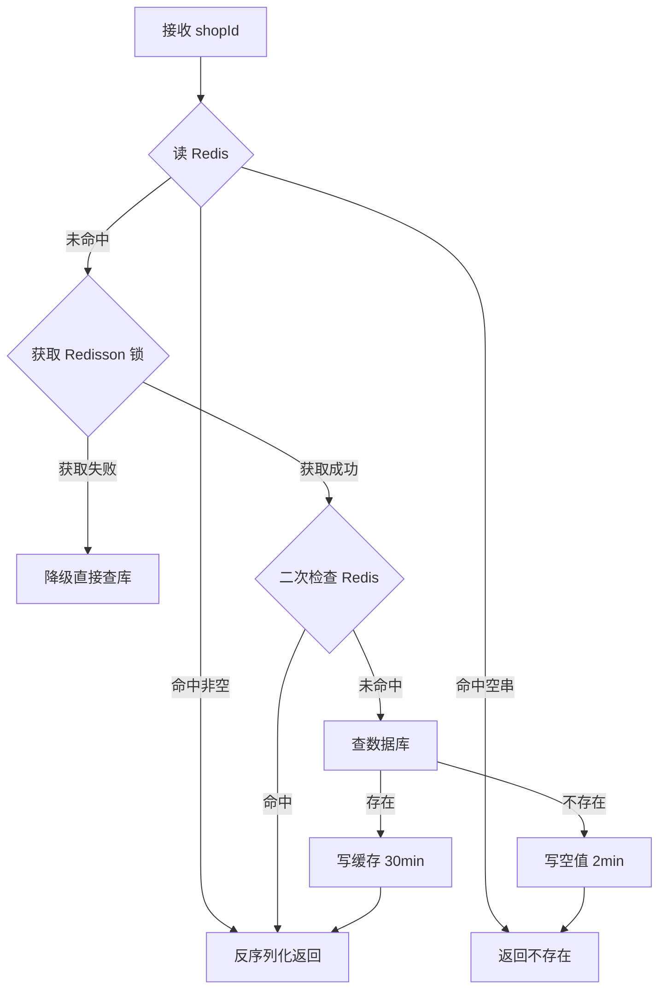

# 商铺缓存设计

## 1. 场景与目标

商铺详情是典型的「读多写少」数据：首页、详情页、附近推荐都会访问。目标是在保证数据可接受一致性的前提下，把大部分读请求挡在 Redis，避免数据库被打穿。

实现位置：`ShopServiceImpl#queryWithMutex`。

## 2. 缓存模型

```text
cache:shop:{shopId} -> JSON(Shop)     普通缓存，TTL 30 分钟
cache:shop:{shopId} -> ""             空值缓存，TTL 2 分钟
lock:shop:{shopId}                    Redisson 互斥锁
```

查询流程：



## 3. 三个经典问题

### 3.1 缓存穿透

**问题**：大量请求查询不存在的 id，缓存永远不命中，全部打到数据库。

**方案**：数据库查不到时写入空字符串，TTL 2 分钟。下一次相同 id 的请求直接返回“不存在”。

**取舍**：

- 空值缓存占内存，但 TTL 短，可接受。
- 如果恶意用户随机生成海量不重复 id，空值缓存也挡不住；更完整的方案是布隆过滤器 + 参数校验 + 限流。

### 3.2 缓存击穿

**问题**：热点 key 过期瞬间，大量并发请求同时回源。

**方案**：Redisson 分布式锁。只允许一个线程回源重建缓存，其余线程：

- 当前实现：`tryLock(3s, 10s)` 拿不到锁时降级直接查库，保证响应时间；
- 另一种常见策略：自旋等待并重试读缓存，吞吐更低但数据库压力更小。

获取锁后必须**二次检查缓存**，因为等锁期间可能已有其他线程完成重建。

### 3.3 缓存雪崩

**问题**：大量 key 在同一时间过期，或 Redis 整体不可用，请求全部落到数据库。

**当前实现**：不同业务 key 的 TTL 不同；商铺缓存 30 分钟、空值 2 分钟、分类 60 分钟。

**仍可改进**：

- TTL 增加随机抖动，例如 `30min + random(0, 5min)`；
- Redis 集群/哨兵 + 本地缓存（Caffeine）做二级兜底；
- 对数据库做限流和熔断。

## 4. 缓存一致性

更新逻辑：先更新数据库，再删除缓存（Cache-Aside 的常见写法）。

```java
updateById(shop);
stringRedisTemplate.delete(CACHE_SHOP_KEY + shop.getId());
```

**为什么是删除而不是更新缓存？**

- 更新缓存可能写入一个中间状态，且并发更新时顺序不可控；
- 删除更简单，下一次读请求会按最新数据库值重建。

**仍存在的边界**：

- 删除缓存失败会导致脏读，可引入消息队列重试删除；
- 极端并发下（读请求在更新前读库、更新后写缓存）仍可能写入旧值，可用延迟双删或订阅 binlog 解决；
- 本项目定位是学习/实践，优先保证代码清晰，生产环境应结合业务一致性要求选择方案。

## 5. 为什么用 Redisson 而不是手写 SETNX

项目早期版本使用 `SETNX + 过期时间` 实现锁，存在两个问题：

1. **误删别人的锁**：线程 A 超时释放，线程 B 拿到锁，A 恢复后删除 B 的锁；
2. **不可重入、续期困难**：业务执行时间超过锁租期时，需要看门狗机制。

Redisson 的 `RLock` 提供：

- 锁值带线程标识，只允许持有者释放；
- 可重入；
- 看门狗自动续期（使用默认 leaseTime 时）；
- 获取锁支持等待时间。

对应代码：`RedisConfig#redissonClient`，参数统一复用 `spring.data.redis.*`。

## 6. 可继续优化的点

- 热点 key 本地缓存（Caffeine）+ Redis 二级缓存；
- 缓存预热：大促前批量加载热点商铺；
- 布隆过滤器拦截非法 id；
- 缓存命中率、回源 QPS 的 Micrometer 指标；
- 使用 `RedisTemplate` 的批量命令减少 RTT。
