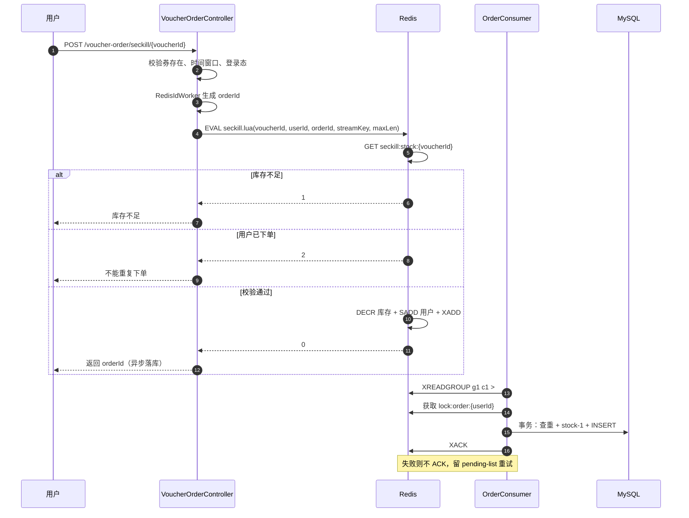

# 优惠券秒杀设计

## 1. 目标与约束

秒杀的核心矛盾：

- 瞬时流量远大于库存；
- 不能超卖；
- 同一用户不能重复下单；
- 数据库写入是瓶颈，接口必须尽量少做同步 DB 操作；
- 消息可能重复、消费可能失败，最终要保证订单可追溯。

本项目用到的组件：

| 组件 | 作用 |
| --- | --- |
| Redis Lua | 原子完成库存校验、一人一单校验、扣减、写消息 |
| Redis Stream | 秒杀请求的异步消息队列 |
| Redisson RLock | 消费端按用户加锁，保证一人一单落库 |
| MySQL 事务 | 最终订单落库与库存扣减 |

## 2. 整体流程



## 3. 为什么用 Lua

如果在 Java 里分三步执行：

```text
GET stock
SISMEMBER order
DECR stock
```

无论怎么加锁，都可能出现「检查通过但执行前状态被其他请求改变」的窗口。Redis 单线程执行 Lua，脚本内的所有命令作为一个整体执行，天然满足原子性。

`seckill.lua` 做了 5 件事：

1. 读库存，`stock <= 0` 返回 `1`；
2. `SISMEMBER seckill:order:{voucherId} userId`，已下单返回 `2`；
3. `INCRBY stock -1`；
4. `SADD seckill:order:{voucherId} userId`；
5. `XADD stream.orders MAXLEN ~ N * userId voucherId id`。

返回值约定：

| 返回值 | 含义 |
| --- | --- |
| `0` | 抢购成功，消息已入队 |
| `1` | 库存不足 |
| `2` | 重复下单 |

## 4. 一人一单

Redis 层用 `Set` 记录已下单用户，保证接口层快速拦截。数据库层在事务中再查一次：

```java
Long count = query().eq("user_id", userId).eq("voucher_id", voucherId).count();
if (count > 0) { ... return; }
```

两层校验的原因：

- Redis 是内存数据，可能丢失或重建；
- 消息可能重复投递，消费端必须幂等；
- 数据库唯一索引是最终兜底（本项目未加唯一索引，生产建议加 `UNIQUE(user_id, voucher_id)`）。

消费端还按用户加 Redisson 锁，避免同一用户的多条消息并发落库：

```java
RLock lock = redissonClient.getLock("lock:order:" + userId);
lock.tryLock(3, 30, TimeUnit.SECONDS);
self.createVoucherOrder(order);
```

> 注意：`createVoucherOrder` 通过注入的自身代理调用，否则 `@Transactional` 不会生效。

## 5. 为什么用 Redis Stream

| 方案 | 优点 | 缺点 |
| --- | --- | --- |
| 阻塞队列 `BlockingQueue` | 简单 | 进程重启丢消息，不能多实例消费 |
| Redis List | 简单、速度快 | 无消费组、无 ACK、无 pending 管理 |
| **Redis Stream** | 消费组、ACK、pending-list、消息持久化 | 不是专业 MQ，运维能力弱 |
| RabbitMQ / Kafka | 成熟、可靠、生态好 | 增加部署复杂度 |

本项目的定位是「已使用 Redis 的业务系统，尽量少引入外部组件」，因此在 Redis 内完成异步下单；如果业务规模继续增长，替换为 RabbitMQ/Kafka 是自然演进。

## 6. 失败处理

### 6.1 消费失败

- 处理抛异常时**不 ACK**，消息留在 pending-list；
- 消费循环捕获异常后调用 `handlePendingList()`；
- 应用重启后会先处理 pending 消息，再读取新消息。

### 6.2 重试上限与死信

- 通过 `XPENDING` 读取每条消息的投递次数；
- 超过 `MAX_DELIVERY_COUNT = 5` 时，写入 `stream.orders.dead` 并 ACK；
- 运维可以通过 `XRANGE stream.orders.dead - +` 查看死信。

### 6.3 数据库扣库存失败

Redis 已经预占了库存和用户标记，如果数据库扣减失败：

```java
stringRedisTemplate.opsForValue().increment("seckill:stock:" + voucherId);
stringRedisTemplate.opsForSet().remove("seckill:order:" + voucherId, userId);
```

把预占资源回滚，避免 Redis 库存永久少卖。

### 6.4 消息重复

- 消费前查数据库是否已有订单；
- 生产环境建议加数据库唯一索引，重复插入直接失败，再按幂等处理；
- 本项目已在 `tb_voucher_order` 上增加 `(user_id, voucher_id)` 唯一索引，作为 Redis Set 和代码查重之外的最终兜底。

### 6.5 用户级限流

`seckill-rate.lua` 对每个用户维护 `seckill:rate:{userId}` 计数器：

```text
INCR key
if count == 1 then EXPIRE key 1 end
if count > limit then return 0 end
```

- 原子执行，不需要额外分布式锁；
- 默认每秒 5 次，可通过 `SECKILL_RATE_LIMIT` 调整；
- 被限流的请求计入 Prometheus 指标 `seckill_requests_total{result="rate_limited"}`。

### 6.6 运维接口

- `GET /voucher-order/admin/stream/pending`：消费组 pending 总数、最小/最大消息 ID、各消费者积压。
- `GET /voucher-order/admin/stream/dead?count=20`：查看死信消息。
- `POST /voucher-order/admin/stream/dead/replay/{id}`：把死信重新写回主 Stream 并删除死信。
- 接口统一要求 `X-Admin-Token`，避免暴露运营数据。

## 7. 一致性边界

当前方案是「Redis 预扣 + 异步落库」，在极端情况下：

- Redis 扣了库存但消息丢失（例如 Redis 持久化配置不当）→ 少卖；
- 数据库扣了库存但 Redis 回滚失败 → 超卖风险。

改进方向：

- 使用 Redis 持久化（AOF everysec）+ 主从/哨兵；
- 增加定时对账任务，比较 Redis 库存、数据库库存和订单数；
- 引入事务消息或本地消息表，保证「扣库存」和「发消息」最终一致；
- 秒杀券库存预热改为从数据库加载后 `SETNX`，避免重启覆盖。

## 8. 面试可展开的问题

1. 为什么 Lua 能保证原子性？Redis 单线程模型和脚本执行的关系。
2. 为什么不用 `SETNX` 直接做秒杀？锁粒度、吞吐、超时释放、误删问题。
3. Redis Stream 的消费组、ACK、pending-list 分别解决什么问题？
4. 消息一直失败怎么办？重试次数、死信、人工补偿、对账。
5. Redis 扣库存成功但数据库失败怎么办？补偿、对账、最终一致性。
6. 如何保证一人一单？Redis Set + DB 查重 + 唯一索引 + 用户级锁。
7. 如何压测？JMeter/wrk 模拟并发，观察超卖、重复订单、RT、Redis/MySQL 指标。
8. 如何防止脚本刷秒杀接口？用户级 Redis 限流、验证码、风控、网关限流的分层设计。
9. 如何处理一直失败的消息？pending 重试、最大投递次数、死信队列、人工重放和对账。
10. 为什么还要数据库唯一索引？Redis 可能丢数据、消息可能重复，唯一索引是最终一致性兜底。
