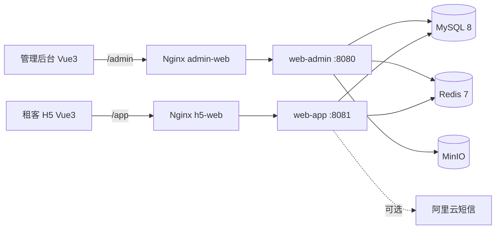

# 寓见公寓 · 智慧公寓租赁服务平台

> 面向房东/公寓运营方与租客的租房平台：管理端负责公寓、房间、租约、预约和系统管理，用户端提供找房、看房、预约、签约和浏览记录等功能。
>
> 后端采用 Spring Boot 3 多模块架构，前端分别为 Vue 3 管理后台和 Vant H5，支持 Docker Compose 一键部署。


---

## 项目组成

| 模块 | 技术栈 | 端口 | 说明 |
| --- | --- | --- | --- |
| `lease` | Spring Boot 3.0.5 / Java 17 / MyBatis-Plus | 8080 / 8081 | 多模块后端，`common` + `model` + `web-admin` + `web-app` |
| `rentHouseAdmin` | Vue 3 + TypeScript + Vite + Element Plus + Pinia + ECharts | 80 | 公寓运营管理后台 |
| `rentHouseH5` | Vue 3 + TypeScript + Vite + Vant 4 + Pinia | 81 | 租客移动端 H5 |

后端公共能力：

- JWT 登录认证（`access-token` 请求头，兼容 `Authorization: Bearer`）
- Redis：管理端图形验证码、用户端短信验证码、验证码发送频率限制
- MinIO：公寓/房间图片对象存储，自动创建 bucket + 公开读策略
- 阿里云短信：可插拔实现，未配置时验证码打印到控制台
- BCrypt 密码加密，兼容历史 MD5 密码并在登录时自动升级
- MySQL 8 + MyBatis-Plus（逻辑删除、分页、自动填充创建/更新时间）
- Knife4j / OpenAPI 接口文档、Actuator 健康检查

## 功能清单

### 管理端（web-admin）

- 公寓管理：公寓信息、房间信息、公寓/房间属性
- 属性管理：配套设施、费用项、标签、租期、支付方式、房间属性
- 租约管理：租约协议、看房预约
- 用户管理：租客信息、系统用户、岗位管理
- 地区管理：省/市/区三级数据
- 报修管理：工单分页、状态筛选、处理备注
- 首页数据概览、图片上传

### 用户端（web-app）

- 手机验证码登录、自动注册
- 公寓列表、公寓详情、房间详情
- 按区域/价格/配套筛选，关键词搜索
- 看房预约、我的预约
- 租约查看、我的租约
- 在线报修：提交、我的报修、取消
- 浏览历史、个人中心、消息

## 系统架构



- `web-admin` 与 `web-app` 共享 `common`、`model` 两个模块，数据库使用同一个 `yujian` 库。
- 前端生产环境通过 Nginx 同源代理，开发环境通过 Vite proxy 转发，避免跨域配置。
- 图片访问地址使用 `MINIO_PUBLIC_ENDPOINT`，容器内上传使用内网 `MINIO_ENDPOINT`。

## 快速开始

### 方式一：Docker Compose（推荐）

前置条件：Docker Engine / Docker Desktop（支持 Compose v2）。

```bash
cp .env.example .env
# 修改 .env 中的数据库密码、JWT_SECRET、MinIO 密码等
docker compose up -d --build
docker compose ps
docker compose logs -f web-admin
```

启动后：

| 服务 | 地址 |
| --- | --- |
| 管理后台 | <http://localhost> |
| 租客 H5 | <http://localhost:81> |
| 管理端接口文档 | <http://localhost:8080/doc.html> |
| 用户端接口文档 | <http://localhost:8081/doc.html> |
| MinIO 控制台 | <http://localhost:9001> |
| MySQL（宿主机） | `localhost:3307`，库名 `yujian` |
| Redis | `localhost:6379` |

> MySQL 初始化脚本来自 `lease/src/main/resources/db/lease.sql`，只在数据卷首次创建时执行。需要重置数据时执行 `docker compose down -v` 后重新启动。

### 演示账号

- 管理后台：`admin / 123456`（另有 `user / 123456`）。首次登录会把数据库里的 MD5 密码自动升级为 BCrypt。
- 数据库初始化脚本内置一条报修工单，管理端登录后可在「报修管理」菜单查看并处理。
- 租客 H5：输入任意手机号获取验证码；默认关闭阿里云短信，验证码会打印在 `web-app` 日志中：

```bash
docker compose logs -f web-app | grep "DEV SMS"
```

### 方式二：本地运行

前置条件：JDK 17、Maven 3.9+、MySQL 8、Redis 7、MinIO（可选，管理端上传图片时需要）。

```bash
# 1. 初始化数据库
mysql -uroot -p -e "CREATE DATABASE IF NOT EXISTS yujian DEFAULT CHARACTER SET utf8mb4 COLLATE utf8mb4_unicode_ci;"
mysql -uroot -p yujian < lease/src/main/resources/db/lease.sql

# 2. 启动 Redis 和 MinIO（按你的安装方式）

# 3. 构建后端
cd lease
mvn clean package -DskipTests

# 4. 设置环境变量后启动两个服务
export DB_PASSWORD=你的密码
export JWT_SECRET=至少32字节的随机字符串
export MINIO_ENDPOINT=http://localhost:9000
export MINIO_PUBLIC_ENDPOINT=http://localhost:9000

java -jar web/web-admin/target/web-admin-1.0-SNAPSHOT.jar   # :8080
java -jar web/web-app/target/web-app-1.0-SNAPSHOT.jar        # :8081
```

前端开发模式：

```bash
cd rentHouseAdmin && npm ci && npm run dev
cd rentHouseH5 && npm ci && npm run dev -- --port 5174
```

开发环境默认代理到 `http://localhost:8080`（管理端）和 `http://localhost:8081`（用户端）。

## 配置说明

### 后端环境变量（两个服务通用）

| 变量 | 默认值 | 说明 |
| --- | --- | --- |
| `SERVER_PORT` | admin 8080 / app 8081 | 服务端口 |
| `DB_HOST` / `DB_PORT` | `localhost` / `3306` | MySQL 地址 |
| `DB_NAME` | `yujian` | 数据库名 |
| `DB_USERNAME` / `DB_PASSWORD` | `root` / 空 | 数据库账号 |
| `REDIS_HOST` / `REDIS_PORT` | `localhost` / `6379` | Redis 地址 |
| `REDIS_PASSWORD` / `REDIS_DATABASE` | 空 / `0` | Redis 认证与库号 |
| `JWT_SECRET` | 开发用默认值 | 生产必须替换，至少 32 字节 |
| `JWT_EXPIRATION` | `7d` | token 有效期 |
| `MINIO_ENDPOINT` | `http://localhost:9000` | 服务端访问地址 |
| `MINIO_PUBLIC_ENDPOINT` | `http://localhost:9000` | 浏览器访问地址 |
| `MINIO_ACCESS_KEY` / `MINIO_SECRET_KEY` | `minioadmin` / `minioadmin` | MinIO 账号 |
| `MINIO_BUCKET` | `yujian` | 图片 bucket |
| `SMS_ENABLED` | `false` | 是否启用阿里云短信 |
| `SMS_ACCESS_KEY_ID` / `SMS_ACCESS_KEY_SECRET` | 空 | 阿里云短信 AccessKey |
| `SMS_TEMPLATE_CODE` / `SMS_SIGN_NAME` | 测试模板 | 短信模板与签名 |

### Docker Compose 变量

见 [`.env.example`](.env.example)，包括宿主机端口、数据库密码、JWT 密钥、MinIO 账号、短信配置等。

## 报修工单接口

用户端（需要 `access-token`）：

| 方法 | 路径 | 说明 |
| --- | --- | --- |
| POST | `/app/repair` | 提交报修（类型、标题、描述、房间 id） |
| GET | `/app/repair/my` | 我的报修分页 |
| GET | `/app/repair/{id}` | 报修详情（只能看自己的） |
| PUT | `/app/repair/{id}/cancel` | 取消报修 |

管理端（需要 `access-token`）：

| 方法 | 路径 | 说明 |
| --- | --- | --- |
| GET | `/admin/repair/page` | 工单分页，支持状态/类型/关键词筛选 |
| GET | `/admin/repair/{id}` | 工单详情 |
| PUT | `/admin/repair/{id}/handle` | 处理工单（处理中/已完成 + 备注） |

状态流转：`0 待处理 -> 1 处理中 -> 2 已完成`，待处理/处理中可取消为 `3 已取消`。

## 项目结构

```text
智慧公寓租赁服务平台/
├── lease/                          # 后端多模块工程
│   ├── common/                     # 通用配置：JWT、Redis、MinIO、短信、异常、结果
│   ├── model/                      # 实体、枚举、基础实体
│   ├── web/
│   │   ├── web-admin/              # 管理端 API :8080
│   │   └── web-app/                # 用户端 API :8081
│   ├── src/main/resources/db/      # 数据库初始化脚本（29 张表 + 演示数据）
│   └── Dockerfile
├── rentHouseAdmin/                 # Vue 3 管理后台
│   ├── src/
│   ├── nginx.conf
│   └── Dockerfile
├── rentHouseH5/                    # Vue 3 + Vant 租客端
│   ├── src/
│   ├── nginx.conf
│   └── Dockerfile
├── docker-compose.yml
├── .env.example
└── README.md
```

## 构建与测试

```bash
# 后端：编译 + 单元测试 + 打包
cd lease
mvn clean package

# 管理端
cd rentHouseAdmin
npm ci && npm run build

# 用户端
cd rentHouseH5
npm ci && npm run build
```

当前单元测试覆盖：

- JWT 签发/解析、非法 token、弱密钥校验
- token 请求头解析（access-token / Bearer）
- 验证码生成
- 管理端 YAML 配置加载

依赖 MySQL/Redis/MinIO 的完整业务流程建议在 Docker Compose 环境中验证。

## 设计说明

### 1. 认证与密码

- 登录成功后签发 JWT，token 放在 `access-token` 请求头；拦截器解析后把用户放入 `ThreadLocal`，请求结束清理，避免线程池复用导致的数据串号。
- 管理端登录使用 Redis 图形验证码；用户端使用短信验证码，并在 Redis 中维护发送频率限制。
- 管理端历史密码是 MD5，登录成功后自动用 BCrypt 重新加密写回数据库，实现平滑迁移。

### 2. 多环境配置

- 数据库、Redis、MinIO、JWT、短信全部通过环境变量注入，仓库中不包含任何真实密钥。
- `application.yml` 中的默认值只用于本地开发，生产环境必须覆盖 `JWT_SECRET`、数据库密码、MinIO 密码。

### 3. 文件存储

- 上传接口调用 MinIO SDK，bucket 不存在时自动创建并设置公开读策略。
- 返回给浏览器的 URL 使用 `MINIO_PUBLIC_ENDPOINT`，避免容器内网地址暴露给前端。

### 4. 报修工单状态机

- 用户创建工单时只能写入自己的 `userId`，状态固定为待处理，处理人和备注由服务端清空。
- 用户只能查看/取消自己的工单；已取消、已完成的工单不能再次取消。
- 管理端处理时校验目标状态只能是“处理中/已完成”，已取消或已完成的工单不能重复处理。
- 状态常量集中在 `RepairStatus`，避免魔法数字。

### 5. 登录安全

- 管理端连续 5 次密码错误后，Redis 记录失败次数并锁定账号 15 分钟。
- 登录成功后清除失败计数；密码使用 BCrypt，兼容历史 MD5 并在登录时自动升级。

### 6. 部署

- 后端使用 Maven 多阶段构建，运行时使用 JRE 镜像并以非 root 用户启动。
- 前端构建后由 Nginx 托管，`/admin`、`/app` 分别反向代理到两个后端容器。
- MySQL、Redis、MinIO 均配置 healthcheck，后端通过 `depends_on: condition: service_healthy` 等待依赖就绪。

## 安全提醒

- 部署前务必修改：`JWT_SECRET`、`DB_PASSWORD`、`MINIO_ACCESS_KEY/SECRET_KEY`、管理员密码。
- 默认关闭真实短信，生产环境配置阿里云短信并设置 `SMS_ENABLED=true`。
- 管理端登录连续失败 5 次会锁定 15 分钟；上传仅接受 jpg/jpeg/png/webp/gif 且不超过 10MB，文件名由服务端生成。
- 生产环境建议：HTTPS、MinIO 私有桶 + 预签名 URL、限制管理端访问来源、接入统一的日志与监控。

## 开发说明

本项目的业务原型来自公开的智慧公寓租赁学习资料，仓库中的代码在此基础完成了工程化重构与扩展：包结构与品牌化、配置外置、JWT/SMS/MinIO 安全改造、BCrypt 密码迁移、Docker/Nginx 部署、单元测试与文档等。H5 端的 UI 基础来自 MIT 协议的 [`vue3-h5-template`](https://github.com/yulimchen/vue3-h5-template)，原始 LICENSE 保留在 `rentHouseH5/LICENSE`。
